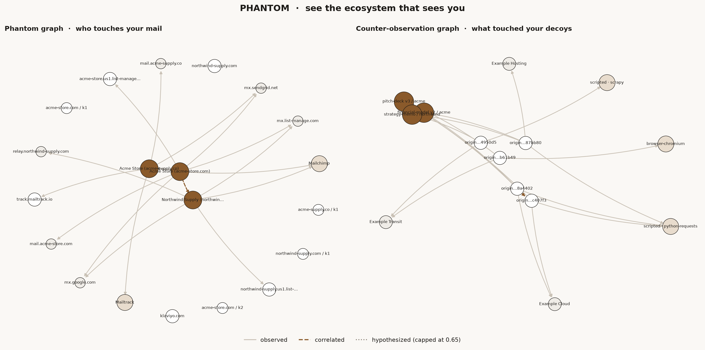

# PHANTOM

**Privacy Intelligence & Relationship Mapping Platform**

*See the ecosystem that sees you.*

PHANTOM is not another tracker blocker. A blocker hides the tracker. PHANTOM maps
the infrastructure behind it: which organisation sent the message, which third
parties served its content, which provider sits underneath them, and which
relationships that implies. Then it shows you the evidence for every line it
draws, and marks the lines it cannot prove.

```
        reads                      resolves                    draws
  your mail metadata  ──▶  tracker + provider registry  ──▶  an evidence-backed graph
                                     │                              │
                                     ▼                              ▼
                        what changed over time          what is still unknown
```



*Left: the phantom graph from the demo corpus. Right: the counter-observation graph
after seven simulated canary fetches. Line style encodes the class: solid is
observed, dashed is correlated, dotted is hypothesized. There is a third layer now;
see [`docs/shadow-trace.md`](docs/shadow-trace.md).*

---

## Why this exists

Every tracking pixel is a small admission. It tells you that a company bought
email analytics, that a provider is relaying its mail, that its links are
rewritten through a click tracker. None of that is visible in your inbox. All of
it is visible in the message headers and the HTML, if someone bothers to look
and then shows their work.

Most tools stop at "3 trackers blocked". PHANTOM answers the harder questions:

- **Who** is behind this message, underneath the display name?
- **What** infrastructure connects organisations that have no obvious relationship?
- **How sure** are we, and what exactly is the evidence?
- **What stopped appearing**, and what does that absence mean (and not mean)?
- **What is PHANTOM itself** doing to you while it audits everyone else?

---

## Scope

One product: **which organisations and infrastructure can observe this person's
email, and what is the evidence for each claim.** Six modules at v0.1 became nine at
v0.2, and none of that came from a user asking for it. Growth in module count is not
growth in usefulness, so the boundary is written down and enforced by a freeze rule:
bug fixes are allowed everywhere, new nouns are not. See [`docs/scope.md`](docs/scope.md).

## Three layers

PHANTOM holds three kinds of relationship at once, in three node namespaces that do
not collapse into each other:

| Layer | Question | Joined by |
| --- | --- | --- |
| **1 · Surveillance** | Who is positioned to observe you? | ordinary message evidence |
| **2 · Relationship** | Who do you actually talk to? | never becomes an edge; local report only |
| **3 · Adversarial** | What tried to reach what you protect? | only a human-confirmed bridge |

The interesting part is the intersections, and the discipline is refusing to read
them as identity. Layer 3 shares node keys with the counter-observation module, so a
canary fetch and a refused decryption request from the same origin land on the same
node. What it never does is decide that a shared observable means a shared operator.
That join requires a person, a written rationale, and an explicit decision.

## The ideas

| # | Idea | Where it lives |
| --- | --- | --- |
| 1 | **Shadow ecosystem** — track the trackers, not just detect them | `backend/phantom/collector/`, `engine/` |
| 2 | **Phantom graphs** — three edge classes, evidence on every edge | `engine/classify.py`, `engine/relationship_engine.py` |
| 3 | **Metadata-first Gmail** — headers before bodies, two explicit tiers | `collector/gmail.py` |
| 4 | **Local exposure analysis** — contacts never leave the machine | `exposure/local_contacts.py` |
| 5 | **Negative space + self-audit** — record absence, audit yourself | `watchdog/`, `selfaudit/` |
| 6 | **Counter-observation** — make an extraction attempt reveal itself | `mirror/` |

### 1. The shadow ecosystem

Given one authorised message, PHANTOM extracts its relay chain, DKIM identity,
authentication results, routing headers, embedded pixels and click-redirect
wrappers, then resolves each domain against a small, reviewable registry. What
comes out is a graph of organisations, domains, mail hosts and providers.

### 2. Phantom graphs

A relationship graph shows what is known. A *phantom* graph also shows what is
possible and what is missing:

| Classification | Meaning | Confidence ceiling |
| --- | --- | --- |
| `observed` | Directly detected in a message you authorised | 0.99 |
| `correlated` | Recurring technical overlap across independent messages | 0.85 |
| `hypothesized` | A pattern that requires verification | 0.65 |

A hypothesized edge can never be promoted by volume alone. Every edge above
`observed` carries a standing caveat that the API and the UI are required to
display: shared infrastructure does not establish common ownership,
coordination, or data exchange.

### 3. Gmail integration, honestly

The convenient claim is "read-only Gmail". The honest version is that pixels
live in the body, so a metadata scope cannot see them. PHANTOM ships two tiers
and says so in the UI:

- **Metadata tier** (default, `gmail.metadata`): headers, labels, auth results.
  Sender infrastructure and relay chains, no pixels.
- **Body tier** (explicit opt-in, `gmail.readonly`): adds HTML so pixels and
  redirect wrappers become visible. The body is parsed in memory and discarded;
  only the URL, the reason it was flagged, and a hash survive.

PHANTOM never requests `gmail.send` or `gmail.modify`. It cannot send, label or
delete your mail. See [`docs/gmail-scopes.md`](docs/gmail-scopes.md).

### 4. Contact exposure without a social graph

The interesting question is where your digital exposure overlaps with the
organisations you already deal with. The dangerous implementation is uploading an
address book and building a relationship database out of other people's data.

PHANTOM does the narrow thing instead: you point it at a CSV **you** exported, it
discards names, raw addresses and phone numbers immediately, keeps only domains,
and tells you which of those domains also appear in your observed tracking
infrastructure. Opt-out by domain or by category. Nothing leaves the machine.

It also keeps four relationship kinds strictly separate, because they are not
interchangeable: `contact_record`, `technical_relationship`,
`communication_relationship`, `speculative_association`.

### 5. Negative space, and who watches the watchers

**Negative space** records what stops being observable: a pixel that disappears,
a redirect chain that shortens, infrastructure that changes. Every such event is
stored with `cause_unknown = true`, because a tracker going quiet is not proof
that tracking stopped. It might simply have moved somewhere you cannot see.

**Self-audit** is the part that keeps PHANTOM honest. All outbound traffic goes
through one chokepoint (`phantom/egress.py`) that checks an explicit allowlist
and logs every attempt, blocked ones included. `phantom selfaudit` scans the
source for code that bypasses it, lists which dependencies can open sockets, and
reports what actually left the machine.

```console
$ phantom selfaudit
Declared outbound hosts: oauth2.googleapis.com, gmail.googleapis.com, accounts.google.com
Unmediated network paths found: 0
Verdict: No unmediated outbound code paths found.
```

### 6. Counter-observation

A tracker blocker hides the tracker. PHANTOM also offers a way to learn about the
collector. Canary tokens are decoy images with an opaque token unique to one copy of
one document. When the document is extracted, the canary is fetched, and that request
volunteers its own network origin, client stack and timing.

```console
$ phantom mirror-demo
simulated 7 canary fetches across 5 origins
  leaked: pitch-deck v3 / acme        hits=3 clients=['browser-chromium', 'scripted']
  leaked: financial-model v2 / acme   hits=2 clients=['scripted']
  leaked: strategy-memo / northwind   hits=2 clients=['scripted']

7 canary fetch(es) from 5 origin(s) using 3 client stack(s) across 3 known network(s).
campaign clusters: 1 (hypothesized)
guardrails: retaliation=False raw_ip_retained=False
```

Those hits become a second graph, built by the same engine with the same three
classes and the same provenance rule: origins, client stacks and networks, joined by
`accessed_canary`, `shares_origin_infrastructure_with` and `campaign_cluster_with`.

**The line, stated up front:** this is passive. PHANTOM serves the image, writes a
row, and does nothing else. `RETALIATION_ENABLED = False` is hard-coded, not a
setting, because hacking back is illegal, attacks whoever owns the host actually
making the request, and would make this tool the surveillance layer it exists to
reveal. The graph holds canaries, origins, client stacks and networks. There is no
person at any node, and a test asserts that too. See
[`docs/counter-observation.md`](docs/counter-observation.md).

### 7. ShadowTrace, MirrorLock and the evidence vault

Layer 3 records interactions with infrastructure you control, and keeps them
verifiable:

```console
$ phantom shadow-demo
layer 3 events: 8  {'decoy_access': 4, 'protected_data_request': 3, 'payload_quarantined': 1}
outcomes: {'observed': 4, 'denied': 2, 'granted': 1, 'quarantined': 1}
  touched: decoy:pitch-deck v3              events=2 ['observed']
  touched: vault:fe435ee2…                  events=2 ['denied']
  touched: payload:bbe38aaf…                events=1 ['quarantined']

recurring indicators: 4
co-occurrence candidates: 3 (hypothesized, capped)
quarantined payloads: 1 (executed: False)
vault: intact (8 records)
automatic layer merges: 0
```

- **MirrorLock** encrypts protected objects against the local key and brokers every
  decryption request. Denial is the default. A refusal is recorded either way, because
  a refusal is the most informative event in the layer and the easiest one to lose.
- **The evidence vault** is an append-only hash chain. Each record commits to its
  predecessor and is sealed with a key that never leaves the machine, so editing,
  deleting or reordering history is detectable: `phantom vault-verify`.
- **Payload quarantine** keeps a suspicious sample encrypted and unopened. Never
  executed, never unpacked, never rendered.
- **Anything credential-shaped is refused.** A request carrying `password=…` is stored
  with the secret replaced, and the tests assert it never reaches the database.

The rule that makes this credible rather than alarming: **a refusal is not an
accusation.** An expired grant and a hostile probe produce the same row, the report
says so next to the count, and every event is stored with its innocent explanations
attached.

See [`docs/shadow-trace.md`](docs/shadow-trace.md),
[`docs/identity-separation.md`](docs/identity-separation.md) and
[`docs/evidence-vault.md`](docs/evidence-vault.md).

Your own accounts across platforms, and what already links them:
[`docs/own-account-inventory.md`](docs/own-account-inventory.md).

What the system refuses, what it cannot do, and where the risk that remains
actually sits: [`docs/trust-boundaries.md`](docs/trust-boundaries.md). The ten
findings from the adversarial review, with a pinning test for each:
[`docs/reviews/2026-11-01-adversarial.md`](docs/reviews/2026-11-01-adversarial.md).

---

## Quickstart

```bash
git clone <your-fork> && cd phantom
python -m venv .venv && source .venv/bin/activate
pip install -e "backend[dev]"

# Run the whole pipeline over the synthetic sample corpus.
phantom demo          # email graph, negative space, self-audit
phantom mirror-demo   # counter-observation graph
phantom shadow-demo   # layer 3: decoys, refusals, quarantine, hash chain
phantom vault-verify  # recompute the evidence chain
phantom rebuild-graph # throw away every claim and re-derive it from observations
```

`phantom demo` ingests `samples/*.eml`, builds the graph, runs the negative-space
scan and the self-audit, and writes:

```
out/report.md            human-readable findings
out/graph.json           Cytoscape elements, with provenance counts
out/negative-space.json  recorded changes in observability
out/selfaudit.json       PHANTOM's own footprint
```

Sample output, abridged:

```
ingested 6 messages
  acme-store.com         pixels=1 redirectors=1 dmarc=pass providers=Mailchimp
  northwind-supply.com   pixels=1 redirectors=1 dmarc=pass providers=Mailchimp
  acme-store.com         pixels=0 redirectors=0 dmarc=pass providers=-
  acme-supply.co         pixels=1 redirectors=0 dmarc=pass providers=Mailtrack

graph: 20 nodes, 17 edges {'observed': 15, 'correlated': 1, 'hypothesized': 1}
negative space: 6 observation(s) of change
self-audit: No unmediated outbound code paths found.
```

### Other commands

```bash
phantom ingest path/to/message.eml   # fold one message into the local graph
phantom graph                       # print Cytoscape JSON
phantom exposure contacts.csv       # local contact exposure check
phantom enroll --gmail you@gmail.com --consent-gmail
phantom selfaudit                   # audit PHANTOM's own network footprint
```

### API and UI

```bash
uvicorn phantom.main:app --reload --app-dir backend   # http://127.0.0.1:8000/docs
cd frontend && npm install && npm run dev             # http://localhost:5173
```

---

## Architecture

Six components, deliberately separable so the risky parts can be omitted:

| Component | Responsibility | Code |
| --- | --- | --- |
| **Phantom Collector** | Authorised ingestion, headers and URL extraction | `collector/` |
| **Tracker Registry** | Domain and provider identification, with sources | `registry/` |
| **Relationship Engine** | Evidence-backed graph construction | `engine/` |
| **Phantom Graph** | Uncertainty and relationship visualisation | `engine/graph.py`, `frontend/` |
| **Exposure Analyzer** | Local-only contact intersection analysis | `exposure/` |
| **Temporal Watchdog** | Historical change and negative space | `watchdog/` |
| **Counter-observation** | Canaries, attempt fingerprinting, counter-graph | `mirror/` |
| **ShadowTrace** | Layer 3 adversarial events, recurrence, temporal proximity | `shadow/` |
| **MirrorLock** | Cryptographic protection with a deny-by-default broker | `shadow/mirrorlock.py` |
| **Evidence Vault** | Append-only sealed event chain | `shadow/vault.py` |

Plus one that is not on the original list and should be:
**Self-audit** (`selfaudit/`), which keeps the other six accountable.

```
backend/phantom/
├── collector/      header + HTML parsing, Gmail two-tier client
├── registry/       curated tracker data (YAML, reviewable in a diff)
├── engine/         rules, classification, graph assembly
├── exposure/       local contact intersection analysis
├── watchdog/       negative space
├── selfaudit/      egress allowlist, scanner, own-footprint report
├── mirror/         canary tokens, attempt fingerprinting, counter-graph
├── auth/           Gmail OAuth + per-field revocable consent
├── api/            FastAPI surface
├── egress.py       the single outbound chokepoint
└── crypto.py       local key, encryption at rest
```

Stack: Python 3.11, FastAPI, SQLAlchemy (SQLite by default, PostgreSQL if you
configure it), NetworkX, React + Vite + Cytoscape.js, Docker.

---

## Security posture

- **Least privilege OAuth.** Metadata scope by default; body scope only on
  explicit opt-in; never `send` or `modify`.
- **No sending, ever.** No route in the API can send mail or a text message.
- **No contact uploads.** Contact analysis runs locally on a file you exported.
- **Fail closed.** Unlisted hosts raise `EgressBlocked` before a byte leaves;
  malformed data is refused rather than guessed at.
- **Provenance required.** The engine will not write an edge without at least one
  evidence row. A test asserts it.
- **Encryption at rest** for the little personal data PHANTOM holds, against a key
  that exists only on your machine.
- **Deletion is a feature.** Consent is per-field, revocable, and cleared
  immediately on revocation.

See [`SECURITY.md`](SECURITY.md) and [`docs/threat-model.md`](docs/threat-model.md).

---

## Documentation

| Document | Contents |
| --- | --- |
| [`docs/architecture.md`](docs/architecture.md) | Components, data flow, storage schema |
| [`docs/edge-provenance.md`](docs/edge-provenance.md) | Every rule, its caveat, and the confidence maths |
| [`docs/negative-space.md`](docs/negative-space.md) | What absence analysis may and may not claim |
| [`docs/gmail-scopes.md`](docs/gmail-scopes.md) | The two tiers and their limits |
| [`docs/privacy-model.md`](docs/privacy-model.md) | What is stored, what is not, retention, deletion |
| [`docs/threat-model.md`](docs/threat-model.md) | Adversaries, including PHANTOM itself |
| [`docs/ethics.md`](docs/ethics.md) | The line between privacy tools and people-tracking |
| [`docs/consent.md`](docs/consent.md) | The consent flow, field by field |
| [`docs/counter-observation.md`](docs/counter-observation.md) | Canaries, the asymmetry, and the passive-only line |
| [`docs/scope.md`](docs/scope.md) | The one product, the frozen list, and the freeze rule |
| [`docs/observations.md`](docs/observations.md) | Raw observations kept apart from derived claims, and rebuilding |
| [`docs/shadow-trace.md`](docs/shadow-trace.md) | Layer 3: what gets recorded and what it may never say |
| [`docs/identity-separation.md`](docs/identity-separation.md) | Why the layers cannot merge, enforced in code |
| [`docs/evidence-vault.md`](docs/evidence-vault.md) | The hash chain, and what it cannot prove |
| [`docs/roadmap.md`](docs/roadmap.md) | What is built, what is next |

---

## What this is not

- Not a service. It runs on your machine, against your data.
- Not a people-finder. Contact analysis yields domains, never relationships
  between people.
- Not a verdict. It reports infrastructure and evidence. It does not tell you
  that two companies are secretly the same company.
- Not an offensive tool. The canary endpoint writes a row and returns a pixel.
  Nothing is sent back to the requester, and no code path could do so.
- Not an attribution engine. It will not tell you that a tracker and a sender are
  the same party. It will show you the shared observable and refuse the inference.
- Not a participant. It never probes, follows, or queries a third party about
  anything that touched it.
- Not finished. See the roadmap; the honest status is "working MVP, single data
  source, small registry".

## License

AGPL-3.0. If you run a modified PHANTOM as a network service, its users are
entitled to the source. A privacy tool that hides its own workings is a
contradiction.
